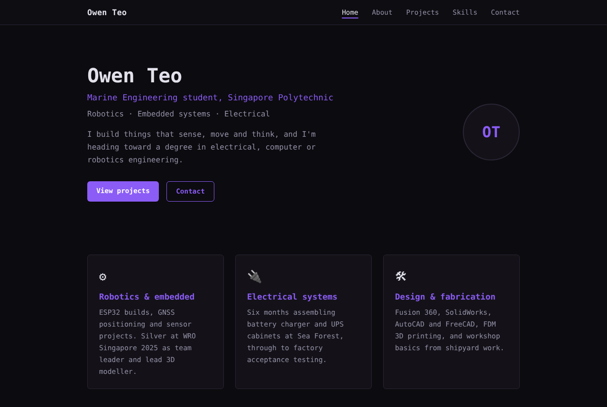

# Owen Teo: portfolio site

My personal portfolio site. I built it with Flask and plain HTML and CSS to show my projects, experience and skills.

**Live site:** https://portfolio-site-sxr1.onrender.com



## What's on it

| Page | What it shows |
| --- | --- |
| `/` | Intro and three highlight cards |
| `/about` | Bio, experience, education, awards and certifications |
| `/projects` | Project cards with dates, status and tags |
| `/skills` | Skills grouped by area |
| `/contact` | Email, LinkedIn and location |

## Built with

- **Flask** for the routes, with **Jinja2** templates for the HTML
- Plain CSS with a dark theme, and no JavaScript framework
- **Gunicorn** on **Render**, which redeploys the site every time I push to `master`

## Run it on your computer

1. Clone the repo and go into the folder:
   ```bash
   git clone https://github.com/owenteo2006-hash/portfolio-site.git
   cd portfolio-site
   ```
2. Make a virtual environment and install the requirements:
   ```bash
   python3 -m venv .venv
   source .venv/bin/activate
   pip install -r requirements.txt
   ```
3. Start the site with auto-reload on:
   ```bash
   FLASK_DEBUG=1 python app.py
   ```
4. Open http://127.0.0.1:5000. On WSL2, if that doesn't load, run `hostname -I` and use the first IP address instead.

Debug mode stays off unless you set `FLASK_DEBUG=1`. The app listens on every network interface, so I don't want Flask's debugger reachable from other devices by accident.

I also run it on my LattePanda IOTA and open it from my other devices over Tailscale.

## How it works

When a browser asks for a page like `/projects`, Flask runs the matching function in `app.py`. That function hands the data to a template, and Jinja2 fills in the HTML before it goes back to the browser. The server does all the work, so the pages need no JavaScript.

```
browser requests /projects
       ↓
Flask matches @app.route("/projects")
       ↓
projects() passes the PROJECTS list to projects.html
       ↓
Jinja2 loops over the list and builds one card per project
       ↓
the finished HTML goes back to the browser
```

`base.html` holds the nav, the footer and the page head, so I only write them once. Every other page extends it:

```html


  ... page content ...

```

## Folders

```
app.py              routes only, no content
data/content.py     every piece of text on the site
templates/          HTML structure, Jinja2 loops and variables
static/css/         styling
static/favicon.svg  the tab icon
tests/              checks that every page loads
docs/               the screenshot in this README
```

## Updating the content

All the text lives in `data/content.py`, so a content change never needs HTML. To add a project, add a dict to the `PROJECTS` list:

```python
{
    "title": "My new project",
    "subtitle": "Personal project",
    "period": "Nov 2026 – present",
    "description": "What it does and what I did.",
    "tags": ["ESP32", "Python"],
    "status": "in-progress",  # "in-progress", "planned" or "complete"
    "link": None,  # or "https://github.com/..."
},
```

The projects page picks it up and builds a new card. The bio is the `about` list in `PROFILE`, and skills are grouped in `SKILLS`.

## Adding a profile photo

Put the photo at `static/img/photo.jpg`, then in `templates/index.html` replace:

```html
<div class="avatar-placeholder">OT</div>
```

with:

```html

```

and add this to `style.css`:

```css
.avatar { width: 120px; height: 120px; border-radius: 50%; object-fit: cover; border: 2px solid var(--border); }
```

## Tests

The tests load every page and check that an unknown address returns a 404.

```bash
pip install -r requirements-dev.txt
pytest
```

## Styling

The dark theme matches my WezTerm terminal setup. Every colour is a CSS variable at the top of `static/css/style.css`, so changing one variable recolours the whole site.

- Background: `#0c0b0f`
- Accent: `#8b5cf6` (purple)
- Fonts: Iosevka SS14, then Cascadia Code, then Fira Code, then the system's monospace font

## Deploying

The site runs on Render's free tier. It sleeps after 15 minutes without visitors, so the first visit after that takes a few seconds. Render rebuilds the site whenever I push to `master`.
